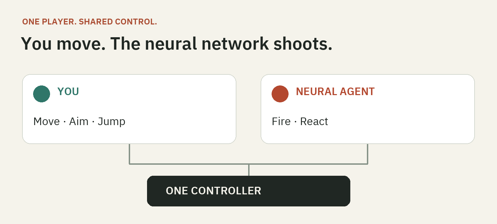
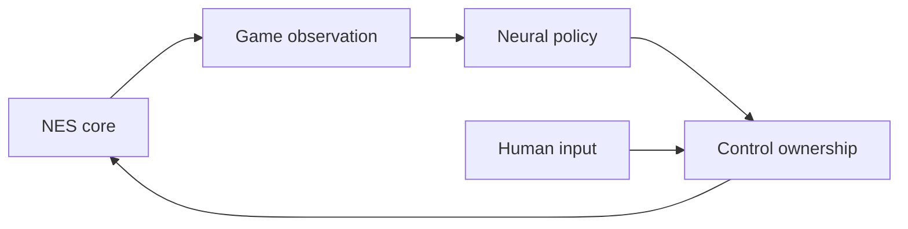

# AgentEmu

**You move. The neural network shoots.**

A Rust NES emulator with neural-network agents and shared human–AI controls.
Play on desktop or in a browser through the same Rust interface.



In **Shared** mode, you and an agent control different buttons of the same
character. For example, you move, aim and jump in Contra while the agent fires.
You can also play alone, with another human, or alongside an AI player.

> Early source release. Code and project-authored models are MIT licensed.
> Agents cover specific game sections, not whole games. Phone, physical gamepad
> and accessibility validation is still in progress. [Validation and limitations](docs/DEVICE-ACCEPTANCE.md).

## Run it

Install [Rust](https://rustup.rs/); the repository pins the toolchain and WASM
target. Native builds need Xcode Command Line Tools on macOS, Visual Studio C++
Build Tools with MSVC on Windows, or ALSA/udev/XKB/Wayland development libraries
on Linux. On Debian/Ubuntu:

```sh
sudo apt-get install libasound2-dev libudev-dev libxkbcommon-dev libwayland-dev
```

```sh
git clone https://github.com/dk8827/AgentEmu.git
cd AgentEmu
cargo run --release --locked -p frontend-native --bin agentemu
```

For the browser, install Python 3.11+ and run from the same checkout:

```sh
cargo install wasm-bindgen-cli --version 0.2.129 --locked
sh scripts/build-web.sh
python3 scripts/serve-web.py
```

Open [localhost:8765/play.html](http://localhost:8765/play.html).
WebGPU is preferred, with WebGL2 fallback. Both applications read your local,
uncompressed `.nes` file. ROMs are not included or uploaded.

## Play with an agent

Open **AI games**, choose a game, set each player to Human, AI or Shared, then
choose your ROM. Select **No player 2** for solo play, including solo Shared play.
Use NES **Start / Select** to operate the game's own menu; the app's Play/Pause
buttons control emulation.

Shared presets assign A, B or A+B to the agent. Direction pairs stay together,
each group has one owner, and Start/Select stay human-controlled. The live input
strip shows your input, the agent's proposal and the applied buttons. Change
ownership while paused, or use **Take full control** to return to human play.

Included agents cover sections of **Contra, Snow Bros., Bubble Bobble,
Ice Climber, Double Dragon II and TMNT II**. They require the exact cartridge
revision listed in their model manifest and pause outside their supported section.
See the [model catalog](docs/MODELS.md) for recommended and experimental models,
benchmarks, and failure cases. Shared mode currently uses autonomous policies;
performance with a human partner needs separate evaluation. Solo execution is
available, but several bundled models do not reliably clear their first section alone.

Keyboard controls are available; gamepad and mobile touch support are experimental
until the physical-device checks are complete. The player includes
sound, battery saves, three save slots, portable save files and controller replays.
[Controls and troubleshooting](docs/PLAYER.md) · [ROM matching](docs/ROM-MATCHING.md)

## How it works

A game adapter reads structured fields such as positions, terrain and enemies
from the emulated state. A small neural network predicts controller buttons once
per emulated frame. Rust runs inference locally on native and WebAssembly targets.
Models are trained with Python/PyTorch, primarily through imitation learning and
DAgger from game-specific teachers. Agents observe game state rather than pixels.



The headless session engine owns execution, input arbitration, pacing and replay.
The Rust UI handles presentation and platform input/audio. Hardware conformance,
native/WASM parity and application tests have local runners and CI definitions.
GitHub Actions is currently disabled; Linux/Windows CI for this snapshot is pending.
Short cartridge traces are
reported separately from gameplay completion. [Compatibility](docs/COMPATIBILITY.md)

## Develop

[Contributor setup and checks](CONTRIBUTING.md) · [Architecture](docs/ARCHITECTURE.md)
· [Add a game integration](docs/ADDING-A-GAME.md) · [Training](docs/TRAINING.md)
· [Documentation index](docs/README.md)

## License

AgentEmu code and project-authored model weights are [MIT licensed](LICENSE).
Fonts, test fixtures and dependencies retain their own terms; see
[third-party notices](THIRD_PARTY_NOTICES.md). Gallery title cards and the control
diagram are original project artwork. No commercial-game imagery is included.
