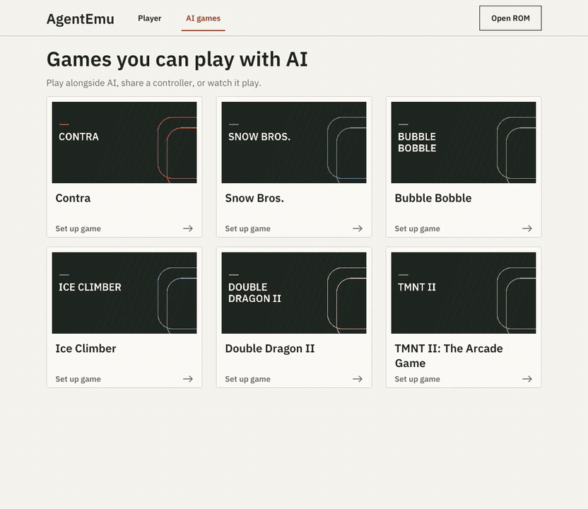
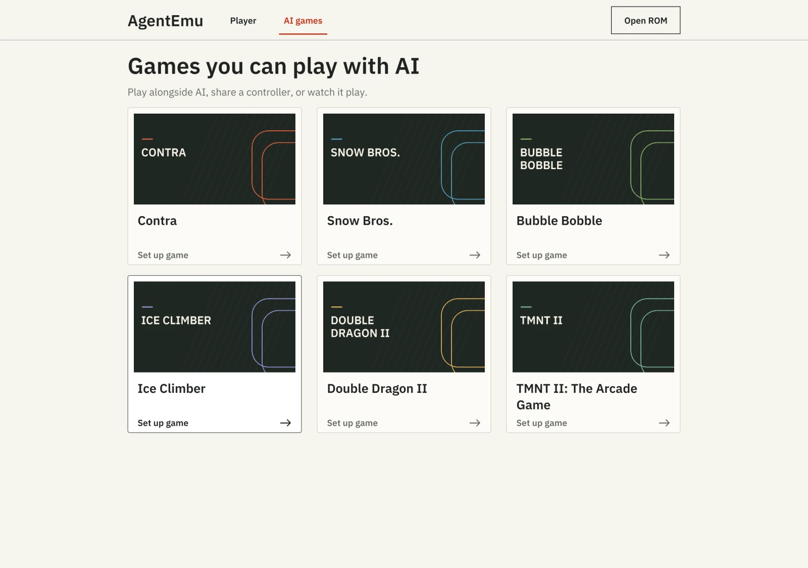
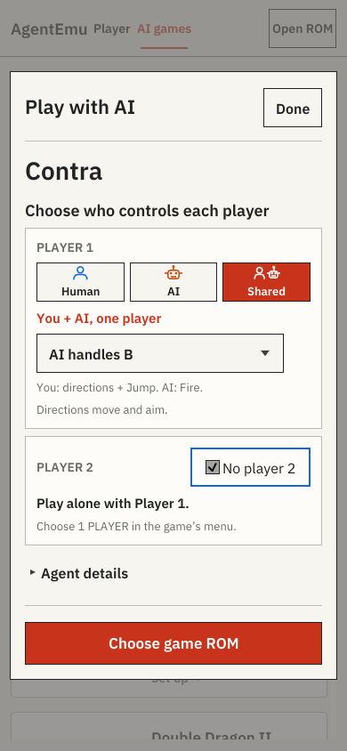
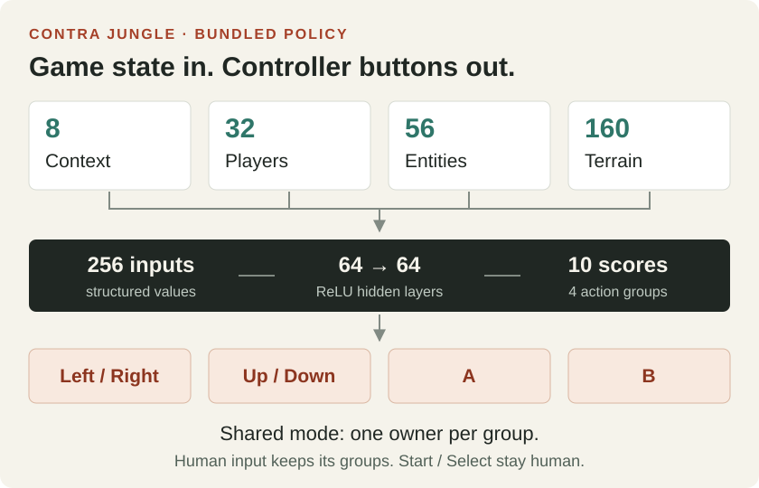

# AgentEmu

### You move. The neural network shoots.

A Rust NES emulator where you can share a controller with a neural-network agent.
Play on desktop or in a browser through the same Rust interface.

[](Cargo.toml)
[](#run-it)
[](LICENSE)


[Run it](#run-it) · [Train an agent](#train-an-agent) · [Included models](docs/MODELS.md) · [Contribute](CONTRIBUTING.md)

## Your controller. Your choice.

| Mode | Who controls the player? |
| :--- | :--- |
| **Human** | You. Play alone or with a friend. |
| **AI** | A neural network. Play alongside it or watch it play. |
| **Shared** | You and the network own different buttons of **one player**. |

In Contra, choose **AI handles B**: you move, aim and jump; the agent fires.
Choose **No player 2** to play solo with Shared control. Presets can also give
the agent A or A+B. Start/Select always stay with you.

<details>
<summary><strong>Watch the Shared-control setup</strong> — choose a game, share player 1, disable player 2</summary>



This is a recording of the setup interface, before loading a ROM. It does not
demonstrate gameplay or agent performance.

</details>

Ownership is exclusive: the agent cannot override your assigned buttons. The
live controller strip shows human input, the AI proposal and the buttons actually
applied. Change ownership while paused, or use **Take full control** to return to
human play.

## One Rust interface, desktop and browser



<details>
<summary><strong>See the mobile browser interface</strong></summary>



Captured at a phone-sized browser viewport; physical-device validation is still
in progress.

</details>

Both use the same Rust UI. Sound, battery saves, three save slots, portable saves
and controller replays are included. Keyboard controls are available; gamepad and
touch support still need physical-device validation.

## What the network sees

Agents read **structured game state**, such as player positions, enemies and
nearby terrain. Each game has its own adapter and observation contract.
The bundled networks run locally in Rust, on native and WebAssembly targets.



This is the bundled **Contra Jungle** schema: 256 inputs, two 64-unit ReLU layers,
and 10 output scores decoded into four controller groups. It reads the current
state each emulated frame; it has no stacked frame history or recurrent memory.
The runtime then applies your ownership settings. Start/Select are outside the
network's outputs. [Observation contracts and runtime](docs/ARCHITECTURE.md)

## Run it

Install [Rust](https://rustup.rs/) and your platform's native build dependencies,
then:

```sh
git clone https://github.com/dk8827/AgentEmu.git
cd AgentEmu
cargo run --release --locked -p frontend-native --bin agentemu
```

<details>
<summary>Native build dependencies</summary>

The repository pins the Rust toolchain and WASM target. Native builds need
Xcode Command Line Tools on macOS, Visual Studio C++ Build Tools with MSVC on
Windows, or ALSA/udev/XKB/Wayland development libraries on Linux. On Debian/Ubuntu:

```sh
sudo apt-get install libasound2-dev libudev-dev libxkbcommon-dev libwayland-dev
```

</details>

<details>
<summary>Run in a browser</summary>

Install Python 3.11+ and run from the same checkout:

```sh
cargo install wasm-bindgen-cli --version 0.2.129 --locked
sh scripts/build-web.sh
python3 scripts/serve-web.py
```

Open [localhost:8765/play.html](http://localhost:8765/play.html).
WebGPU is preferred, with WebGL2 fallback.

</details>

Open **AI games**, choose a game and each player's controls, then choose your
local, uncompressed `.nes` ROM. ROMs are **not included or uploaded**. Use NES
**Start / Select** to choose one or two players in the game's own menu; the app's
Play/Pause buttons control emulation.

[Controls and troubleshooting](docs/PLAYER.md) · [ROM matching](docs/ROM-MATCHING.md)

## Train an agent

Use Python/PyTorch and Gymnasium to train a policy, export its weights, and run
the same network in Rust. The public tools include imitation learning, DAgger,
a Contra PPO example, and native/WASM evaluation.

After [installing the training package](docs/TRAINING.md#install), try the small
Contra pipeline check with your own matching ROM:

```sh
agentemu-train train --rom /path/to/Contra.nes \
  --output .cache/contra-smoke --bc-steps 256 --ppo-steps 0 \
  --horizon 240 --eval-seeds 1 --seed 7
```

It collects teacher labels, fits a network, exports safetensors, checks native
inference parity and evaluates the result. This short **co-op** example checks
the pipeline; it does not train a stage-clearing agent. The guide also covers real
solo environments, other games, evaluation and trying your exported model.

[Training guide](docs/TRAINING.md) · [Add a game integration](docs/ADDING-A-GAME.md) · [Evaluation evidence](docs/EVIDENCE.md)

## Included agents and current limits

Agents are bundled for **Contra, Snow Bros., Bubble Bobble, Ice Climber,
Double Dragon II and TMNT II**. They cover specific sections, require the exact
cartridge revision in their manifests, and pause outside their supported section.
Several models do not reliably clear their first section alone. The
[model catalog](docs/MODELS.md) lists recommendations, results and failure cases.

Shared mode currently uses autonomous policies, not policies trained to respond
to human button presses. Autonomous clear rates do not establish how helpful an
agent is to a human. Phone, physical gamepad and accessibility validation is still
in progress. [Validation status](docs/DEVICE-ACCEPTANCE.md)

Hardware conformance, native/WASM parity and application tests have local runners.
GitHub Actions is disabled; Linux/Windows CI for this snapshot is pending. Short
cartridge traces are reported separately from gameplay completion.
[Compatibility](docs/COMPATIBILITY.md) · [Contributor checks](CONTRIBUTING.md#checks)

## Build with us

[Architecture](docs/ARCHITECTURE.md) · [Contributing](CONTRIBUTING.md) · [Documentation index](docs/README.md) · [Report a bug](https://github.com/dk8827/AgentEmu/issues/new?template=bug.yml)

AgentEmu code and project-authored model weights are [MIT licensed](LICENSE).
Fonts, fixtures and dependencies retain their own terms; see
[third-party notices](THIRD_PARTY_NOTICES.md). The hero is AI-generated project
artwork; interface captures show the real app. No commercial-game imagery is
included. [Visual credits](docs/images/NOTICE.md)
