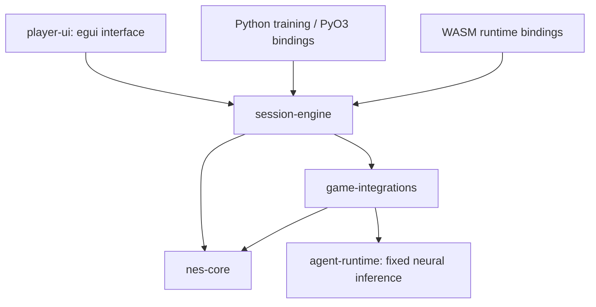

# Architecture

AgentEmu has one headless frame runner and one Rust UI. Native and browser hosts
supply input and presentation; training uses the same emulation and action rules.

## Ownership

- `nes-core`: CPU, PPU, APU, controllers, cartridges and validated machine state.
- `game-integrations`: read-only observations, phase detection, model contracts,
  and exclusive human/policy button ownership.
- `agent-runtime`: bounded safetensors loading, dense inference and action decoding.
- `session-engine`: lifecycle, frame transactions, task episodes, replay and pacing.
- `player-ui`: egui layout, file operations, controller assignment and presentation.
- `frontend-native`: the `agentemu` executable and command-line launch options.
- `web-runtime`: WASM bindings for the browser worker and parity tools.
- `training-bindings`: PyO3 access to typed/batched episodes; Python trainers live
  in `training/contra_training` (a retained import path).

## One emulated frame

The runner checks the fatal-error latch, reads the pre-frame observation, predicts
policy buttons, and arbitrates each owned group. Unsupported gameplay requests a
handoff before advancing. Menus/transitions suppress policy actions. The machine
then advances to the next completed frame and drains generated audio.

Native execution runs on a Rust worker thread; browser execution runs in a Web
Worker. Painting consumes the latest frame. Audio uses bounded queues, and browser
PCM goes directly from the worker to an AudioWorklet. Pause waits for worker stop
before state, game, model or ownership changes. Input and queued audio are released.

## State and compatibility

Portable saves use the `NESSTATE` envelope: exact cartridge identity, core schema,
length and SHA-256 precede compressed state. Restore validates before mutation.
In-process training checkpoints clone typed state, including episode accounting.
Host audio queues are never restored. Versioned replays carry inputs, provenance
and state hashes; intentional behavioral changes require replay-ABI review.

`integrations/*/task.json` and `observation.json` define versioned contracts.
Generated Rust/Python/JS files must pass `scripts/sync-integrations.py --check`.
Feature meaning or order changes require a new schema, not a renamed old model.
`catalog/` selects public metadata and bundled models; fixture suites select tests.

## Testing boundaries

Hardware test ROMs supply independent correctness checks. Native/WASM parity
checks execution agreement, not independent hardware accuracy. Model export
checks logits and decoded buttons; full episodes check deployed inference.
Application tests use original homebrew and actual browser input. Commercial-ROM
benchmarks run locally; bundled model records retain outcomes and hashes without
cartridge or state payloads. See [evidence provenance](EVIDENCE.md).

The Console trait is a small frame/checkpoint boundary for future systems. NES
rendering and game decoders remain system-specific; another console requires its
own core and integrations.
